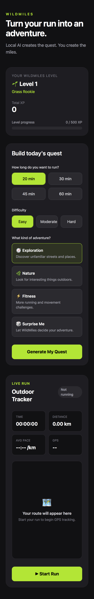
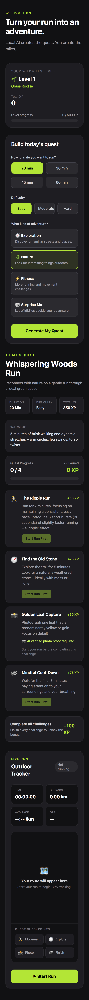
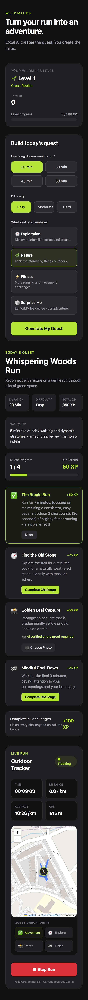
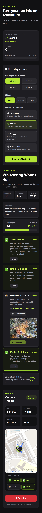

# 🌿 WildMiles

> **AI creates the quest. You create the miles.**

WildMiles is a local-AI outdoor adventure app that turns an ordinary walk or run into a real-world quest.

Instead of keeping users inside another AI interface, WildMiles uses AI to give them a reason to leave the screen behind.

Choose a duration, difficulty, and adventure mode. WildMiles generates outdoor challenges, tracks the run with GPS, records challenge checkpoints, verifies photo challenges with a local multimodal model, awards XP, and can generate an AI-written post-run recap.

---

## ✨ What WildMiles Does

A WildMiles session looks like this:

1. Choose a run duration.
2. Select a difficulty.
3. Pick an adventure mode.
4. Let local AI generate a quest.
5. Start the run.
6. Complete challenges outside.
7. Track the route and challenge locations.
8. Verify photo proof with local AI.
9. Earn XP and progress through levels.
10. Generate an adventure recap after the run.

WildMiles transforms a normal run into a lightweight real-world game.

---

## 🧠 Local AI Quest Generation

WildMiles uses **Gemma 3 4B running locally through Ollama** to generate structured outdoor quests.

Each quest includes:

- a warm-up
- a movement challenge
- an exploration challenge
- an AI-verified photo challenge
- a finish challenge

The model generates the creative parts of the adventure, while deterministic application logic controls game mechanics such as XP.

Example quest:

### Whispering Woods Run

- 🏃 **The Ripple Run**
- 🧭 **Find the Old Stone**
- 📸 **Golden Leaf Capture**
- 🏁 **Mindful Cool-Down**

The quest prompt includes safety constraints so generated challenges avoid dangerous roads, private property, unsafe exercises, and inappropriate interactions with strangers.

---

## 🎮 Adventure Modes

WildMiles currently supports four quest styles:

- 🧭 **Exploration** — discover unfamiliar streets, paths, or nearby places
- 🌿 **Nature** — observe plants, colors, textures, and outdoor details
- ⚡ **Fitness** — generate more movement-focused challenges
- 🎲 **Surprise Me** — let WildMiles choose the adventure

---

## ⏱️ Configurable Runs

### Duration

- 20 minutes
- 30 minutes
- 45 minutes
- 60 minutes

### Difficulty

- Easy
- Moderate
- Hard

These settings are passed into the local AI when generating the quest.

## 📍 Live GPS Run Tracking

WildMiles uses the browser **Geolocation API** to track the run in real time.

During the run, the app displays:

- elapsed time
- distance
- average pace
- current GPS accuracy
- accepted GPS points

The live route is visualized using **Leaflet** and **OpenStreetMap**.

---

## 🧹 GPS Noise Filtering

Browser GPS can drift, especially when the user is stationary.

WildMiles filters GPS readings before adding them to the route.

A GPS point can be rejected when:

- GPS accuracy is worse than the configured threshold
- movement is too small and likely represents GPS drift
- calculated movement speed is unrealistically high

Current filtering thresholds are approximately:

- maximum accepted GPS accuracy: `30 m`
- minimum movement between accepted points: `5 m`
- maximum accepted speed: `10 m/s`

This helps prevent small GPS fluctuations from artificially increasing recorded distance.

---

## 🗺️ Quest Checkpoints

Quest progress is connected directly to the GPS tracker.

When a challenge is completed, WildMiles stores the latest accepted GPS coordinate as a quest checkpoint.

Challenge markers include:

- 🏃 Movement
- 🧭 Exploration
- 📸 Photo
- 🏁 Finish

This means the final map is not just a fitness route. It also becomes a map of the adventure.

```text
START
  │
  ├──── 🏃 Movement
  │
  ├──── 🧭 Exploration
  │
  ├──── 📸 Photo
  │
  └──── 🏁 Finish
```

---

## 📸 AI Photo Verification

One quest challenge requires photo proof.

The user captures or uploads an image and WildMiles sends it to the local multimodal **Gemma 3** model through Ollama.

The model returns structured verification information such as:

```json
{
  "verified": true,
  "confidence": 0.94,
  "reason": "The requested object is clearly visible.",
  "observation": "A bright yellow leaf is visible in the image."
}
```

WildMiles only awards the photo challenge XP after successful verification.

This lets the AI act as a lightweight **real-world quest referee**, rather than only a text generator.

> Local multimodal inference performance depends on the hardware running Ollama and the size of the submitted image.

---

## ⭐ XP and Progression

XP values are deterministic and controlled by application code.

| Challenge | XP |
|---|---:|
| Movement | 50 |
| Exploration | 75 |
| Photo | 50 |
| Finish | 75 |
| Completion Bonus | 100 |
| **Total** | **350 XP** |

AI does **not** decide XP values.

> **AI handles creativity and interpretation. Application code handles game rules.**

---

## 🌱 Player Levels

Progress is stored locally in the browser.

| Level | XP Required | Title |
|---|---:|---|
| 🌱 Level 1 | 0 | Grass Rookie |
| 🌿 Level 2 | 500 | Trail Curious |
| 🌳 Level 3 | 1000 | Outdoor Explorer |
| 🧭 Level 4 | 2000 | Quest Runner |
| 🏔️ Level 5 | 3500 | Adventure Master |

---

## 🏅 Badges

WildMiles includes lightweight achievements.

- 🌱 **First Touch** — complete the first WildMiles quest
- 📸 **Proof of Grass** — pass the first AI photo verification
- 🔥 **Quest Streak** — complete three WildMiles quests
- 🌳 **Nature Seeker** — complete five verified photo challenges

Progress is stored using browser `localStorage`.


# ✨ AI Adventure Recap

After a run finishes, WildMiles can send the completed run context back to the local AI model.

The recap can include:

- total distance
- elapsed time
- average pace
- completed challenges
- checkpoint distances
- photo observation

Gemma converts those run details into a short adventure-style story.

For example, instead of only showing:

> You ran 3.2 km in 24 minutes.

WildMiles can turn the run into something more memorable:

> You started with a movement challenge, explored a new path, completed your photo quest, and finished the adventure after 3.2 km.

The prompt instructs the model not to invent locations, weather, landmarks, or events that were not supplied by the application.

---

## 🔒 Why Local AI?

WildMiles intentionally uses an open-weight model through Ollama.

The application can work with potentially personal information such as:

- outdoor activity
- photographs
- quest history
- route information

For this prototype, AI inference runs locally instead of requiring those inputs to be sent to a hosted third-party AI API.

This demonstrates that useful multimodal AI experiences do not always require cloud-based AI services.

### Model

`gemma3:4b`

### Runtime

`Ollama`

WildMiles is best described as **local-AI / local-first**, not fully offline, because OpenStreetMap tiles and some mobile testing workflows still require internet connectivity.

---

## 🧠 AI vs Deterministic Logic

WildMiles deliberately separates responsibilities.

### AI is used for

- quest generation
- creative challenge instructions
- multimodal photo understanding
- post-run storytelling

### Application code is used for

- XP calculation
- challenge state
- GPS tracking
- GPS filtering
- distance calculation
- pace calculation
- level progression
- badges
- checkpoint recording
- local persistence

This keeps important game mechanics predictable while still allowing each AI-generated adventure to feel different.

---

## 🏗️ Architecture

```text id="gjczc7"
                         ┌─────────────────┐
                         │     Browser     │
                         │   WildMiles UI  │
                         └────────┬────────┘
                                  │
                 ┌────────────────┼─────────────────┐
                 │                │                 │
                 ▼                ▼                 ▼
          Quest System       GPS Tracker      Photo Capture
                 │                │                 │
                 │                ▼                 │
                 │        Geolocation API           │
                 │                │                 │
                 │                ▼                 │
                 │         GPS Filtering            │
                 │                │                 │
                 │                ▼                 │
                 │       Leaflet/OpenStreetMap      │
                 │                                  │
                 └───────────────┬──────────────────┘
                                 │
                                 ▼
                         Next.js API Routes
                                 │
              ┌──────────────────┼──────────────────┐
              │                  │                  │
              ▼                  ▼                  ▼
        /api/quest       /api/verify-photo    /api/run-recap
              │                  │                  │
              └──────────────────┼──────────────────┘
                                 │
                                 ▼
                              Ollama
                                 │
                                 ▼
                           Gemma 3 4B
```

---

## 🛠️ Tech Stack

### Frontend

- Next.js
- React
- TypeScript
- Tailwind CSS

### AI

- Ollama
- Gemma 3 4B
- structured JSON model output
- multimodal image understanding

### Maps

- Leaflet
- OpenStreetMap

### Browser APIs

- Geolocation API
- FileReader
- localStorage

## 📂 Project Structure

```text
src/
├── app/
│   ├── api/
│   │   ├── quest/
│   │   │   └── route.ts
│   │   ├── verify-photo/
│   │   │   └── route.ts
│   │   └── run-recap/
│   │       └── route.ts
│   ├── globals.css
│   ├── layout.tsx
│   └── page.tsx
│
├── components/
│   ├── BadgeList.tsx
│   ├── ChallengeCard.tsx
│   ├── CheckpointStatus.tsx
│   ├── Header.tsx
│   ├── ModeButton.tsx
│   ├── PhotoChallengeCard.tsx
│   ├── PlayerProfile.tsx
│   ├── QuestBuilder.tsx
│   ├── QuestView.tsx
│   ├── RunMap.tsx
│   ├── RunRecap.tsx
│   ├── RunStat.tsx
│   ├── RunTracker.tsx
│   └── Stat.tsx
│
├── lib/
│   ├── constants.ts
│   ├── gps.ts
│   └── progression.ts
│
└── types/
    └── wildmiles.ts
```

The application is split into focused UI components, shared utilities, and reusable types so the main page can primarily coordinate application state and feature interactions.

---

## 🚀 Running WildMiles Locally

### Prerequisites

Before running WildMiles, install:

- Node.js
- npm
- Ollama

### 1. Clone the repository

```bash
git clone https://github.com/vaibhavkrishanyadav/wildmiles.git
cd wildmiles
```

### 2. Install dependencies

```bash
npm install
```

### 3. Download the AI model

WildMiles currently uses Gemma 3 4B.

```bash
ollama pull gemma3:4b
```

Confirm that the model is available:

```bash
ollama list
```

You can optionally test the model directly:

```bash
ollama run gemma3:4b
```

### 4. Start the development server

```bash
npm run dev
```

Open the application at:

```text
http://localhost:3000
```

Make sure Ollama is running while using AI-powered features.

---

## 🏭 Production Build

Create the production build:

```bash
npm run build
```

Start the production server:

```bash
npm start
```

The application will normally be available at:

```text
http://localhost:3000
```

---

## 📱 Mobile Testing

WildMiles was designed as a mobile-first outdoor experience.

During development, the Next.js application and Ollama can run on a computer while the WildMiles interface is opened on a phone through an HTTPS development tunnel.

The architecture looks like this:

```text
Mobile Browser
      │
      ▼
HTTPS Development Tunnel
      │
      ▼
Next.js running locally
      │
      ▼
Ollama
      │
      ▼
Gemma 3 4B
```

The mobile browser handles:

- GPS access
- camera and photo selection
- user interaction
- live route visualization

The local computer handles:

- Next.js API routes
- local AI inference through Ollama

This setup is intended for development and demonstration. A production version would use a more robust deployment or local-device architecture.

---

## 📸 Screenshots

<table>
  <tr>
    <td align="center">
      
      <br/>
      <b>Quest Setup</b>
    </td>
    <td align="center">
      
      <br/>
      <b>Generated Quest</b>
    </td>
  </tr>
  <tr>
    <td align="center">
      
      <br/>
      <b>Live GPS Run</b>
    </td>
    <td align="center">
      
      <br/>
      <b>Quest Progress</b>
    </td>
  </tr>
</table>

---

## 🧪 Example Test Run

One prototype test generated:

### Whispering Woods Run

> Reconnect with nature on a gentle run through a local green space.

The quest contained:

- 🏃 **The Ripple Run**
- 🧭 **Find the Old Stone**
- 📸 **Golden Leaf Capture**
- 🏁 **Mindful Cool-Down**

During the test run, WildMiles recorded approximately:

```text
Distance: 1.49 km
Elapsed time: 13:59
Average pace: 9:21 /km
GPS accuracy: ±6 m
Quest progress: 3 / 4
```

The live map displayed the accepted GPS route along with the completed challenge checkpoints.

## ⚠️ Prototype Limitations

WildMiles is a hackathon prototype rather than a production fitness tracker.

### Local Ollama Dependency

The Next.js server expects Ollama to be available locally.

### Mobile Remote Access

The prototype can use an HTTPS development tunnel when accessing the local server from a phone.

A production version would need a more robust deployment or local-device architecture.

### Map Connectivity

OpenStreetMap tiles currently require network connectivity.

Because of this, WildMiles is local-first rather than fully offline.

### GPS Accuracy

Browser GPS quality varies depending on:

- device
- environment
- signal quality
- browser behavior

The current filtering system reduces obvious GPS noise but is not intended to replace a dedicated fitness tracker.

### Background Tracking

Mobile browsers may pause or reduce location tracking when:

- the browser is backgrounded
- the phone is locked
- the operating system limits background activity

### Multimodal Inference Performance

Local image verification can be slower than text generation depending on:

- CPU/GPU availability
- model loading state
- available memory
- image dimensions
- image file size

---

## 🌿 Design Philosophy

WildMiles follows three core principles.

### 1. The Screen Should Be the Shortest Part of the Experience

The goal is not to create another AI product that keeps the user interacting with a screen.

WildMiles uses AI to create a reason to step away from the device and do something in the physical world.

### 2. AI Should Handle Ambiguity, Not Everything

AI is useful for:

- creativity
- image understanding
- natural-language generation
- storytelling

Traditional deterministic code is better suited for:

- GPS calculations
- XP
- progression
- checkpoints
- application state
- validation

WildMiles combines both rather than forcing AI into every part of the product.

### 3. Location-Aware Experiences Deserve Privacy-Aware Architecture

Outdoor applications can involve sensitive context such as:

- location
- photographs
- routes
- activity history

Running an open-weight model locally provides a way to experiment with these experiences while keeping AI inference under the user's control.

---

## 🔮 Future Improvements

There are many directions WildMiles could grow in.

Potential improvements include:

- Progressive Web App support
- offline map caching
- daily quests
- quest history
- run history
- route export
- route-aware quest generation
- landmark-aware exploration
- configurable local models
- faster photo verification
- better image compression
- adaptive quests based on previous runs
- voice-guided challenges
- accessibility-focused walking quests
- friend challenges
- shared adventures
- more badges and progression
- on-device AI inference

The core idea would remain the same:

> **Use AI to create more reasons to spend time away from AI.**

---

## 🏆 Hacktoberfest 2026

WildMiles was created for the **Hacktoberfest 2026 Week 1 — Touch Grass DEV Challenge**.

The project started from one simple question:

> **Can AI encourage people to spend less time interacting with AI?**

WildMiles is my attempt to answer that question.

Instead of measuring success by how long someone talks to the model, WildMiles tries to make the AI interaction as short as possible:

1. generate the adventure
2. go outside
3. complete it in the real world
4. return for verification and a recap

**AI creates the quest. You create the miles.**

🌿

---

## 🤝 Contributing

WildMiles is an experimental open-source project.

Contributions, ideas, issues, and improvements are welcome.

Interesting areas for contribution include:

- mobile UX
- GPS filtering
- prompt design
- local-model support
- multimodal verification
- accessibility
- offline mapping
- quest generation
- performance improvements

---

## 🌿 WildMiles

**AI creates the quest. You create the miles.**